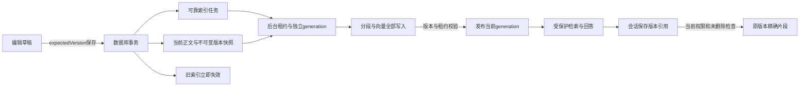

# 第二步：文档—索引—引用一致性验收

起点：`integration/core-baseline` / `19c61c1d5a6aa59b08226d24af66aeb6574a6639`。实施与验收日期：2026-10-21～26。

**验收结论：第二步在约定的无需外部模型范围内通过。主体实现、自动回归、真实浏览器闭环、后台故障矩阵及环境收尾均已核对。**

## 用户决策已经落实的行为

文档保存或恢复历史内容后，旧索引立即退出新的检索和问答。新索引排队、构建或失败时，不回退旧内容。历史回答的引用继续指向回答当时的版本，打开时重新检查当前文档权限和删除状态。

1. 保存携带期望版本，服务端在同一数据库事务中保存正文、不可变快照和可靠索引任务；并发旧版本保存被拒绝，草稿保留。恢复历史内容产生新的版本号。
2. 后台读取已保存快照进行分段和向量化；每次尝试使用独立generation。所有数据写完且版本、配置、状态、租约均有效后，才能发布为当前可检索索引。
3. 检索和回答核验当前有效generation；保存过程中或生成过程中依据失效时明确报错。旧向量即使尚未清理，也不能参与新的回答。
4. 引用包含文档、版本、片段位置和hash，随助手消息持久化。点击来源返回对应快照的精确片段，并标记当前/历史版本；不把最新正文替换成历史依据。
5. 页面分别显示保存、草稿、解析和索引状态。摘要存在不再代表AI就绪；索引受理也不等于完成。

## 已复核的验证证据

所有原始日志、JSON及截图位于Git忽略的 `.local/consistency-evidence/`，凭据不进入报告或提交。下表不同测试集合可能重叠，不相加为独立测试总数。

| 检查 | 结果与证据 |
| --- | --- |
| 后端完整本地回归 | AI353项中350通过、3项真实Qdrant跳过；document38/38。`backend-full-third.log` |
| AI后续受影响专项 | 45/45。`backend-targeted-final.log` |
| 最终GC崩溃窗口与解析版本增量 | AI13/13、document38/38，两服务打包成功。`backend-incremental-final.log` |
| 前端自动检查 | 专项67、既有会话42、独立startup1、async2，共112项通过；生产构建通过。`frontend-*-20261022.log` |
| 真实初始化、禁用模型、索引发布与权限 | 10/24的Initialize2、Disabled1、QueueSynthetic1、Ready3、Permissions5，共12项通过；生产worker在模型禁用时明确FAILED且不提供旧索引 |
| 重新启动后的旧数据 | 10/26恢复后原V1 generation、分段与引用仍实际可读，Ready3/3；没有重建已有夹具充当持久化恢复 |
| 保存V2后的AI闸门 | worker暂停期间，真实search/query均409 `INDEX_NOT_READY`且无正文。`runtime-v2-queued-ai-gate.json` |
| V2发布后的新回答 | 真实query200，全部引用为V2。`runtime-v2-current-answer.json` |
| 历史片段 | V1引用仍返回原切片且HISTORICAL。`runtime-Historical-20261026-020858.json` |
| 删除 | 合成文档软删除后，状态及原引用404，原文不返回。`runtime-Deleted-20261026-142503.json` |
| 真实Edge页面 | answer/save/ready/history/deleted五阶段通过，各阶段pageError为0，无HTTP mock；证据 `frontend-browser-{answer,save,ready,history,deleted}.json` |
| 历史分页 | 真实会话API以limit=1遍历4页，核对2条消息无重复且引用保留；页面重开及刷新后引用面板仍逐字对应V1 |
| 后台故障矩阵 | 26/26通过：部分向量写入失败后重试、构建中保存/迟到发布拒绝、进程中断租约恢复、禁用失败及显式重试、恢复历史为新V7、受控manifest故障清理恢复。`worker-reliability-20261026-143006.json` |
| 前端收尾 | 浏览器各阶段关闭；Vite已停止，5173无监听。`frontend-cleanup-20261026.json` |
| 后台最终收尾 | 2个测试文档软删除，pendingCleanup=0，16个generation的manifest/向量/metadata无残留；恢复普通Disabled生产JAR。`runtime-final-state.json` |

主协调已复核原始回归结果、HTTP状态记录、故障矩阵JSON、页面JSON和当前/历史/删除引用截图。引用断言限定在引用面板内，不依赖编辑区出现相同文本；READY截图重取等待展开动画完成，原始帧记录保留。

清理故障通过在隔离DB11中替换本轮测试generation的单个manifest为无效JSON注入，随后恢复原值，真实worker第二次清理成功；实际检查对应manifest、向量和metadata不存在。该场景证明受控坏数据下的清理失败记录与恢复，不等于整个Redis集群容灾。迟到完成的人工请求仅用于验证真实退休租约被拒绝，所有成功发布均由真实worker完成。

真实浏览器使用Vite开发模式。成功链中的Embedding和回答为明确标识的测试作用域替身，仍执行真实worker、文档HTTP、MySQL、Redis DB11、基线VectorStore及会话存储。生产JAR不包含测试模型类。本轮没有验证外部模型效果。

## 修改范围与部署事实

- document-service：正文与版本快照、canonical文本/hash、parser_version、版本并发保护、索引任务/租约/原子发布、引用解析、严格JWT身份和增量schema。
- ai-service：索引worker、generation存储与持久清理记录、有效版本检索、五种分段策略的原文位置、引用传播与持久化、旧手工正文索引入口的明确迁移提示。
- web：版本保存/恢复、协作保存、真实索引状态、Dashboard、四个回答入口的共享引用面板及历史消息映射。
- scripts/consistency：隔离运行、就绪检测、真实HTTP和故障矩阵；docs/consistency记录契约、实施报告及证据。

完整文件与实际命令分别见 [文档服务报告](document-2026-10-21.md)、[AI后端报告](backend-2026-10-21.md)、[前端报告](frontend-2026-10-21.md)、[真实运行报告](runtime-2026-10-25.md)。原有失败日志保留，修复后的通过结果不抹去首次失败。

数据库迁移前已有私有备份。原有重复legacy历史保留，可信新版本使用可空唯一标识；不猜选旧历史，不自动覆盖原上传文件。正文升级LONGTEXT，新快照记录规范化与解析来源版本。旧文档需要明确格式并保存后才能形成可信索引。

最终保留原3篇active文档、6条legacy版本，以及原文件、不可变快照和历史会话。真实worker完成索引删除后，收尾仅精确移除两份测试夹具的16组墓碑。五后台服务及五隔离依赖容器继续运行；AI/document使用普通生产JAR、模型禁用，没有测试classpath。真实登录成功，未迁移legacy文档的检索返回409 INDEX_NOT_READY。临时Vite与浏览器已结束。

## 本地交付与下一步

实现、测试、运行脚本及报告固定于 `integration/core-baseline` 的本地提交，提交说明为 `feat: align document snapshots, index generations and citations`。提交前执行范围核对和 `git diff --cached --check`；`.local`中的凭据、数据库备份、运行日志与截图保持忽略，不随提交发布。具体提交号见本次聊天交付记录，或按上述提交说明查询Git日志。

本阶段完成后可进入路线第三步的范围讨论：收尾Review M0并接前端，复用本轮已验证的版本与引用契约。尚未自动开始第三步、接入外部模型或合并main；真实模型召回/回答质量需要单独评测。

## 结论边界

- 真实外部Embedding、生成质量、Tavily、全部文档格式、生产规模/容灾及生产静态托管未验收。真实成功链使用基线VectorStore；3项真实Qdrant测试跳过，不能宣称本轮重新完成Qdrant端到端验收。
- 新检索维持用户私有索引范围，协作者不会自动获得另一用户的私有索引；引用打开时另按当前文档ACL核验。
- 每次检索最多100个可见文档，每代最多10000段；章节分段原有短章节/导言处理局限保留。上述边界不等同于生产性能承诺。
- 清理持久记录保留精简ID供重启与迟到写回收；长期归档压缩不在本轮。文档软删除与原文件回收站不是同一操作，历史恢复仅用于仍可访问的文档。
- 不合入Review M0，不推送远端，不更新main。
